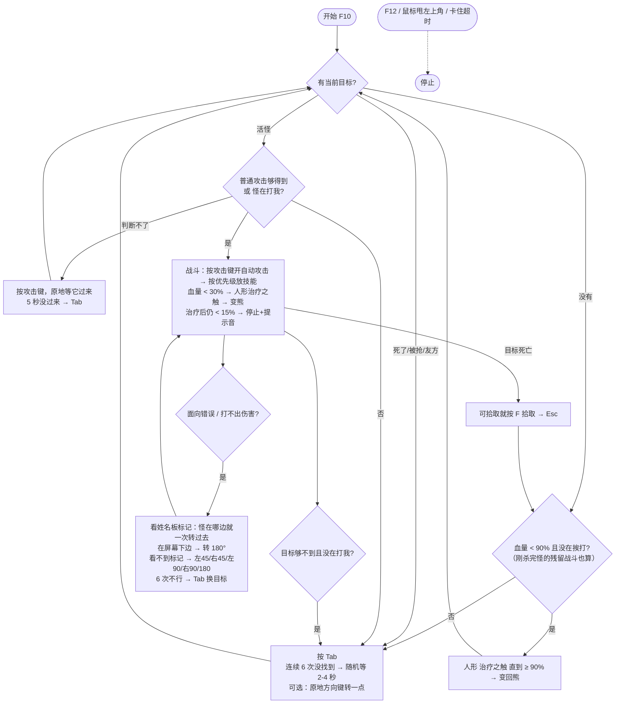
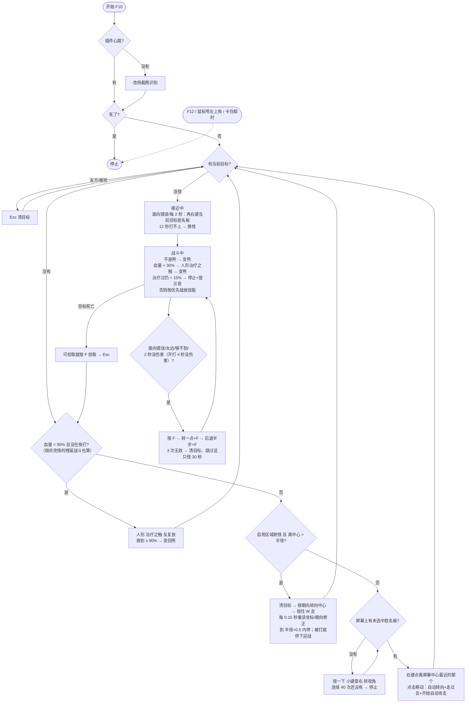

# WowGrinder：熊德自动打怪（原地 Tab 版）

纯截图加模拟按键，不读取游戏内存，也不注入。
**状态优先读 BotStatus 插件**画在屏幕左上角的色块：血量、战斗、目标、目标死亡、可拾取、距离、红字报错、形态、施法和法力。读不到插件心跳时，自动改用截图识别血条。
适用于 1920x1080 全屏或无边框窗口。

> **v8.47 少死**（不用 /reload，重开 WowGrinder 即可；插件还是 v0.13）：① **多怪变熊默认关**（技能循环页的开关；来回变身太费蓝），一直用猎豹，变身预留只按变猎豹算；② **修正“实测变身耗蓝”**：治疗之触读条超时还在读、刚放回春术/补 buff、刚复活回蓝 的 3 秒内变身不测（以前会测出 45-48%，把预留抬到 50%，挡掉救命的治疗）；取最近 3 次中位数，最多 = 预留设置 + 8（`heal.reserve_learn_cap_pct`）；③ **战后治疗**：血量 < 60% 生命之触，60%–85% 回春术，≥ 85% 不治疗（治疗页“低于多少用生命之触 / 低于多少用回春术”）；④ **法力 ≥ 50% 才开怪**：脱战时法力低于“开怪最低法力”（默认 50%）→ Tab、看到的怪、远处的红名、走路时 Tab 都不开，原地回蓝到 50% 再找怪，不管血量；被打照常迎战；最多等 300 秒（防读数异常卡死）。

> **v8.46 提高效率**（不用 /reload，重开 WowGrinder 即可；插件还是 v0.13）：① **就近切换中心**：脱战后离当前中心超出半径、但人已经在另一个（同地图）中心的半径里 → 直接把当前中心换成那个（几个都在 → 最近的），日志 `🚩 已在中心 #N 范围内 → 切换，不走回 #M`；走回中心的路上进了别的中心范围也一样；追怪超上限时也先看是不是在别的中心半径里；去下一个中心的路上不换；来回走的方向照旧 1→2→3→2→1（区域页“就近切换中心”，默认开）。② **先回蓝再开怪**：打完怪 血量 < 60% 且 法力 < 变身预留 + 治疗之触耗蓝 + 10% → 不拉新怪，原地等回蓝（不变形，省变身的蓝；填了“喝水键”就变人形喝一次），蓝到线或血回到 90% 再找怪，最多等 120 秒（超时 60 秒内不再停）；被打照常迎战（治疗页右下）。③ **战斗中治疗线默认 30% → 40%**（28% 才读条常常读不完就死）。④ **怪离得远先走过去**：选中的怪插件距离是 far/ranged → 按住前进朝它走（看标记/姓名板修方向），到近战距离再按开怪键；走 15 秒没到 → 换目标；卡住 2.5 秒 → 改回右键走过去；走的时候不算战斗（高级页“怪远先走过去再开打”）。

> **v8.45 认出“已与服务器断开连接”弹窗**（不用 /reload，重开 WowGrinder 即可；插件还是 v0.13）：v8.44 只认 logo / “进入魔兽世界”按钮 / 选角色顶栏，断线弹窗那个画面一个都没有 → 02:44 断线后 bot 只是“⏸️ 读不到插件色块”等了近 6 小时，一次 Enter 都没按。现在多认一种：**屏幕中间黑底、棕金边框、带红按钮的弹窗**（暴雪对话框统一样式）——只在插件色块读不到时才算（游戏里“释放灵魂”、Esc 菜单也长这样，那时插件读得到，不会按）。另外：① 已经在重连时，界面没认出来、插件也读不到超过 30 秒（比如弹窗关掉后的登录界面）→ 照样每 10 秒按 Enter，直到进游戏；② 平时插件读不到 30 秒又没认出断线界面 → 自动存一张截图（logs/shots，名字带 addon_lost）+ 分数，发给我就能加识别。**登录界面要输密码的话 bot 不会输**（不存也不输密码），只能你自己登。

> **v8.44 断线自动重连**（不用 /reload，重开 WowGrinder 即可；插件还是 v0.13）：插件色块读不到时，截图看是不是**断线弹窗 / 登录界面 / 选角色界面**（认左上角“魔兽世界 无限”logo、选角色界面的“进入魔兽世界”红按钮、顶上“商城/选项菜单/规则集”一排，模板在 `images\glue\`，取自你电脑上的真实选角色界面）。连续认出 2 秒 → 日志“🔌 认出断线/登录/选角色界面…”，然后**每 10 秒按一次 Enter**（日志“🔌 断线 → 按 Enter 重连（第 N 次）”），不设放弃时间；读条时不按，等着；插件色块又读得到 = 进游戏了 → “✅ 重连成功 → 继续打怪”。只在游戏窗口在前台时按；游戏世界里（插件读得到）永远不按 Enter。设置在“安全”页最下面：“断线自动重连（v8.44）”（默认开）、“重连按 Enter 间隔(秒)”（默认 10）。**游戏客户端整个关掉/崩溃了不管**（不会重开游戏）。

> **v8.43 去掉自动停止**（不用 /reload，重开 WowGrinder 即可；插件还是 v0.13）：按你的选择去掉 5 种自动停止——① 出错太多就停 → 永远重试（连续出错等 2→4→8→16→30 秒）；② 死亡就停 → 不停（跑尸关着就等活过来）；③ 治疗后血量仍低于 15% 就停 → 每场提醒一次 + 提示音，继续打；④ 目标血量 25 秒不掉就停 → 只提醒、截图，继续打；⑤ 鼠标甩到左上角急停 → 去掉。现在只有 **F12 / 停止按钮 / 关窗口** 能停。“安全”页去掉了“死亡时自动停止”和“鼠标甩到左上角急停”两个勾选框，“卡住超时”改名“卡住提醒”。

> **v8.42 治疗时多留蓝，保证治完能变回猎豹**（不用 /reload，重开 WowGrinder 即可；插件还是 v0.13）：19:07 那次连放 3 个治疗之触，蓝从 62% 掉到 27%，变猎豹要约 29%，人卡在人形一直按 z。原因：① 第 2 个治疗之触读条超过 5 秒（挨打推迟）bot 就当它结束了，其实游戏里还在读、蓝还没扣（显示 62%）；② 实测治疗之触耗蓝时把读条期间回的蓝也算进去了，测成约 15%（实际约 20%）。现在：① 实测耗蓝 = 读条中最高法力 − 读完后，按最近 3 次里最贵的算（没测到用“治疗之触耗蓝约”设置值 20%）；② 读条超时结束但还在读 → 那个治疗之触的蓝算“还没扣”；③ 每放一个治疗前算“治疗后法力”，要 ≥ 变身预留 + **变身余量**（新设置，“插件与区域”页治疗设置那一栏“变身余量(%)（v8.42）”，默认 3）才放，否则写一行“💧 留蓝变猎豹：预计治疗之触后法力 X% … < 变猎豹需要 Y% → 不再治疗”；④ 战斗中蓝不够变身时不再连按变身键，写一行“💧 法力 X% 不够变猎豹…→ 等回蓝再变”，每 5 秒试一次，蓝够了马上变。人形下不加普攻（按你的选择）。

> **v8.41 修“死了不跑尸”**（不用 /reload，重开 WowGrinder 即可；插件还是 v0.13）：19:07 那次 bot 报“目标血量 25.0 秒没有下降”**自动停止**了，停了以后被怪打死，自然不会跑尸。原因有两个：① 战斗中治疗（这次放了 3 个治疗之触，约 19 秒）的时间被算进了这 25 秒；② 说明里写的是“关闭战斗补救时才停”，代码却不管补救开没开都停。现在：治疗结束重新计时；战斗补救开着（默认）时不再停止，只写一行 ⚠️ 提醒、重新计时继续打（关掉补救才会停）。

> **v8.40 Tab 找怪**（插件要升 **v0.13**，复制 `addon\BotStatus` 到游戏 AddOns 后在游戏里 **/reload** 一次，再重开 WowGrinder）：点击模式下每次找怪（脱战、没目标）**先按选怪键**（“基本设置”页“选怪键”，默认 Tab），插件 v0.13 读目标信息检查：活的、能打；不是灰名（被别人抢了）、不是精英（含稀有精英/世界首领；**稀有非精英照打**）、不比我高 3 级以上（高 3 级及以上、骷髅 ?? 都不打）、不是玩家；我离中心不超过 半径 × 追怪上限倍数。合格 → 照原来的“选中目标 → 右键走过去开打”；不合格 → 这一轮再按 1 次 Tab 换下一个（一轮最多 2 次，Tab 绕回同一只就停），还不行 → 按清除目标键，**不转身**，接着走原来的流程（点屏幕标记 → 走去远处姓名板/红名），4 秒内找怪不再按 Tab。范围外（追怪上限内）Tab 选中的怪照打，不走回中心；走过去时超过追怪上限照旧放弃。**移动中也按 Tab**：巡逻去下一个中心、走回中心、朝远处姓名板/红名走时每 1.8 秒（随机 ±0.4）按一次，合格 → 停下过去打；不合格 → 清目标接着走（不转身）。跑尸、战斗、拾取/剥皮、回血、补 buff 时不按。读不到的字段一律保守不打（日志写“读不到…（保守不打）”）；插件还是 v0.12 → 不用 Tab 找怪（日志提示 /reload），其余照旧。日志每次 Tab 都写结果（🔎 选中能打的怪 / 不合格：原因 / 没选到）。设置在“姓名板与移动”页右边“Tab 找怪”框：Tab 找怪、移动中也按 Tab、移动中间隔、不打灰名/精英/高级/玩家、高几级以上不打（3）、一轮最多几次、冷却秒数。原地 Tab 模式不变。
> 插件 v0.13：第 1 行多了块 36-39（目标 玩家/精英/稀有、有效位、等级差 6 位），二进制 C 行第 23 块洋红 = v0.13 签名；其余编码不变。

> **v8.39 跑尸路线**（不用 /reload，重开 WowGrinder 即可；插件还是 v0.12）：活着从复活点（墓地）往刷怪区走一遍，在容易卡住的地方前后按 **F6**（“基本设置”页可改）或在“跑尸”页点“添加当前位置”记点，#1 是复活点；“跑尸”页有路线列表，可以删除选中/清空（只存一条路线）。释放灵魂后：从离自己最近的路线点开始（已经走过它——离下一个点比两点之间还近——就从下一个开始）逐个走完，再朝尸体走；走路线途中离尸体 ≤ “路线：离尸体多近就直接去”（默认 1.0 地图坐标）并且比离下一个路线点还近 → 不走剩下的点直接去尸体；离路线点 ≤ 0.15 算走到。某个点卡住照 v8.38 一直绕路（绕的方向以这个点为准）直到走到，不跳过、不停止。不在当前地图的路线点不用。路线为空 = 跟以前一样直接朝尸体走。复活后照常回中心。日志写每个走到的点、从哪个点开始、抄近路。跑尸时位置 60 秒一点没变 → 截图 + 提示“请看一眼游戏画面”（之前两次跑尸失败都是位置完全没变，可能是角色根本没在动或坐标没更新，路线解决不了这种情况）。

> **v8.38 长时间不间断打怪**（不用 /reload，重开 WowGrinder 即可；插件还是 v0.12）：① **被多只怪打时变熊**（“技能循环”页，默认开，只在战斗形态=猎豹时用）：最近 5 秒自己掉血 ≥ 20%，或者选中的怪没在打我、我却还在掉血（5 秒内 ≥ 2 次）→ 判断为同时被多只怪打，按熊形态键变熊，熊形态下按“熊：重殴键”（默认 1，熊形态动作条上 重殴 的键；“熊：横扫键”可选）。战斗中低血治疗照旧（治疗线不变，退熊 → 治疗之触 → 变回熊）；血量已经低于治疗线时先治疗再变熊；法力低于 40% 不变熊。脱战 2 秒，或者变熊 10 秒以上 + 杀了一只 + 8 秒没再判断到多只 → 变回猎豹。② **回中心 / 去中心超时不再停止**：跟卡住 3 次一样，照原方向去下一个中心；只有 1 个中心就地找怪，60 秒后再回。③ **跑尸卡住越绕越大，不再停止**：先跳 + 平移，再后退 + 往左右绕 60/90/120/150/180°，越卡走得越久（2→6 秒），记住走不通的朝向不再试；离尸体明显更近了就从头来。“跑尸最长(秒)”改成“跑尸多久提醒一次”（默认 600 秒写一次日志，不响、不停）；卡住第 5 次和每 30 次自动截图。④ **程序出错不马上停**：记日志、松开按键、等 2 秒继续；10 分钟内出错超过 5 次才停止。鼠标甩到屏幕角落急停、停止热键照旧。其余不变：治疗线 30%、附近红名多少都照样拉、打完不等回血、“目标 25 秒不掉血”照旧停止、游戏窗口不在前台照旧只暂停。

> **v8.37 去掉“怪逃跑追着打”**（不用 /reload，重开 WowGrinder 即可）：v8.35 的追逃跑怪功能效果不好，整个去掉，战斗恢复成 v8.34 的打法（怪跑出近战照旧走原来的“距离太远”补救）；“战斗补救”页的 4 个追怪设置也去掉，旧配置里的 flee 设置自动删除。v8.33/v8.34/v8.36 的改动（快死不停、来回巡逻、红名全窗口、战后放回春术开关）都保留。

> **v8.36 战后放回春术开关**（不用 /reload，重开 WowGrinder 即可）：“基本设置”页“战后治疗（每次战斗结束）”下面新增“战后放回春术”（默认开，跟以前一样）。关掉后：战斗结束血量低于生命之触线（默认 70%）照样放生命之触；高于就不治疗、不变形，直接继续打（日志写一次原因）。战斗中低血量的紧急治疗、跑尸复活后回血不受影响；关掉“战后治疗”时照旧什么都不放。

> **v8.35 怪逃跑追着打（v8.37 已去掉）**（不用 /reload，重开 WowGrinder 即可）：人形怪丝血会逃跑。战斗中目标血量 ≤ 25%、刚才（3 秒内）还在近战距离里、现在连续 2 帧离开近战（插件距离块不是“近战”或普通攻击够不到）→ 算逃跑：按住前进追，朝目标标记边追边转，照常按普通攻击/爪击；贴上了就松开前进接着打，它再跑再追。最多追 10 秒，追不上 → 清掉目标（这只怪 30 秒内不再点），照常拾取/回中心。可以追出巡逻范围，打完再走回去。不放月火术/根须，不用新按键。治疗和跑尸照旧优先（要治疗时会松开前进）。设置在“战斗补救”页：怪逃跑时追着打（默认开）、最多追几秒（默认 10）、追怪时可超出巡逻范围（默认开）、目标血量低于多少%算逃跑（默认 25）。

> **v8.34 远处红名在整个窗口里找**（不用 /reload，重开 WowGrinder 即可）：① 找远处红名不再用旧的“姓名板区域”（只覆盖屏幕左边约 60%），改成按实际游戏窗口大小在整个窗口里找；照旧不找左上角头像/插件色块、自己角色周围、底部动作条，另外不找右上（buff/小地图）、右边一列（任务追踪）、右下面板、左下聊天框（设置 nameplate.red_ui_exclude，按窗口比例）。② “走过去没结果，几秒内不再走”默认 20 → 5 秒（旧配置还是 20 的自动改成 5）。注意：远处的怪要在游戏里打开“敌对 NPC 名字”才会显示红名。

> **v8.33 快死不停 + 来回巡逻 + 卡住不停**（不用 /reload，重开 WowGrinder 即可）：① 开着自动跑尸（插件 v0.12）时，治疗过后血量仍低于危险线（默认 15%）不再停止 bot，日志每场写一次“⚠️ 血量 X% 很危险 → 继续打；死了自动跑尸”，不响提示音；真死了就自动跑尸。关了自动跑尸或插件是旧版时照旧停止 + 提示音。② 变身预留蓝照旧：血量再低也不会把蓝用到预留线以下去放治疗之触（开着跑尸时这种情况也不再响提示音）。③ 修正日志：因为留变身蓝不治疗时，不再多写一行误导的“离上次治疗才 … 秒”。④ 多中心改成来回走：1→2→3→2→1→2…，到头掉头；别的地图的中心照方向跳过。开始时从最近的中心出发，先往编号大的方向（最近的是最后一个就往回走）；F8 重置为从 #1 往上走，F7 添加中心不改方向；在“区域刷怪”页删中心后序号自动调整。2 个中心、1 个中心跟以前一样。⑤ 走路卡住（跳 + 平移 2 次都没用）不再停止：有别的中心 → 照原方向去再下一个中心；只有 1 个中心 / 别的中心都走不过去 → 就地找怪，60 秒内不再走回中心，之后再试。

> **v8.32 非战斗看到怪就打**（不用 /reload）：点击模式下，只要不在战斗中、没选中活怪，连续 2 帧看到能打的怪的插件 黄|蓝 标记（屏幕最上面 23% 不算、8 秒内点空过的位置不算），就先停下、右键点它去打（照旧：停稳 0.3 秒、点前确认 25 像素、0.6 秒内没选上算点空）。本来要做的事打完再做：要捡的尸体记下来（打完脱战再捡）、补 buff、在中心附近等、转满一圈回中心都往后放。不打断的情况：回血/回蓝还没到线、拾取/剥皮/补 buff/治疗读条中、跑尸和复活后回血、在范围外正走回中心（巡逻去下一个中心的路上照旧看到就打，追出范围照旧放弃）。只认插件标记，退回模板时不提前点。设置“非战斗看到怪就打”在“姓名板与移动”页，默认开。

> **v8.31 自动跑尸 + 姓名板显示距离调到最大**（插件要升 v0.12，游戏里 /reload 一次）：死了 → 等 5 秒按“释放灵魂/复活键”（默认 `]`）→ 灵魂状态按插件报的 自己坐标+朝向+尸体坐标 走回尸体（卡住先跳+平移，每 3 次往旁边绕 60° 走 2 秒）→ 出现“复活”框（或离尸体 0.3 以内）停下 → 转一圈（4 × 90°）看附近有没有会打我的怪（灵魂状态下插件给敌对/不友好的怪画 黄|蓝 标记；屏幕上方 35% 以下才算近），有就每 5 秒再看，最多等 30 秒 → 按同一个键复活 → 人形站着回到 血 90% 蓝 80%（血低于 70% 先放一次治疗之触，最多 120 秒，被打就先打）→ 变回战斗形态继续。连续死多少次都不停；跑尸超过 600 秒还没复活才停止。战斗中/跑尸中都不按互动键。
> 游戏里要做一个宏（拖到动作条，绑到 `]`）：`/run if UnitIsGhost("player") then RetrieveCorpse() elseif UnitIsDead("player") then RepopMe() end`
> 设置在新的“跑尸”页（自动跑尸 开关、死后等几秒释放灵魂、复活前看怪、附近有怪最多等、复活后血/蓝回到多少 等），“释放灵魂/复活键”在“基本设置”页。插件不是 v0.12 时死了照旧停止。
> 插件 v0.12 登录 / /reload 时把 nameplateMaxDistance 调到客户端允许的最大值（正式服客户端一般锁 60 码），聊天框打印“姓名板显示距离：N 码”，WowGrinder 日志也写一行。超过这个距离的怪还是只显示名字，程序照旧朝红名走过去。

> **v8.30 战后治疗每场只一次 + 回春术不重复**（不用 /reload）：以前杀完怪“战斗中”还残留时先治疗一次，等真正脱战又治疗一次（连放两次回春术、多变一次形，白费约 35% 蓝）。现在每场战斗只治疗一次：残留战斗时治疗过，真正脱战就不再治疗；治疗完又挨打（接着打下一只）才算新的一场。另外回春术放完 12 秒内（持续时间）战后不再放回春术，也不变形，日志写“不重复放回春术”。生命之触不受影响。设置“回春术冷却：几秒内不重复放(秒)”在“基本设置”页，默认 12，0 = 不限制。

> **v8.29 背包满检测**（不用改插件，不用 /reload）：脱战后拾取/剥皮时，按互动键没反应（没有剥皮读条、尸体一直显示“可拾取”）连续 5 次 → 认定背包满了，日志写“🎒 连按互动键 5 次没反应 → 认定背包满了，关掉拾取和剥皮，只打怪”，放弃这具尸体，这次运行不再拾取/剥皮，状态栏显示“🎒背包满：只打怪”。清完背包后停止再开始就恢复。只数脱战时的按键；有读条或尸体被捡空就清零；进战斗也清零；按完看不到尸体的不算。战斗中从不按互动键。设置在“基本设置”页：背包满检测（默认开）、连续几次没反应算满（默认 5，高级）、两具尸体都没反应才算满（默认关，高级，防误判：比如尸体够不着）。

> **v8.28 找怪只点插件标记 + 先停下再点 + 远处红名走过去**（插件要升 v0.11，游戏里 /reload 一次）：插件给每个能打的怪（活的、敌对、不是玩家、没被别人抢）的姓名板正中间画 黄|蓝 小标记，程序只右键点这些标记，不再用姓名板模板（插件旧/读不到时才退回模板，日志写 ⚠️ 原因）。看到标记先松开移动键停下（点地面后自动在走的，轻点一下后退键停住），停稳 0.3 秒；点之前再截一张图，标记还在原位（25 像素内）才点；点完 0.6 秒内没选上能打的怪 = 点空，那个位置 8 秒内不再点。点中以后角色自己走过去，接近途中不再点；只有停下来还有问题（目标没变近、坐标不动、还报太远/面向错误）才再点，两次右键仍至少隔 3 秒，近战距离规则不变。屏幕最上面 23%（远处）的标记不点；只看到远处的红色名字或最上面的标记时，转过去朝它走，连续 2 帧出现能点的标记就停下点；最多走 10 秒、名字 1.5 秒看不到、走到范围边上、卡住 2.5 秒 → 停下，20 秒内不再朝远处走。巡逻路上连续 2 帧看到标记才停。全程不按互动键。设置都在“姓名板与移动”页（大多在高级设置里）。

> **v8.27 每次战斗结束都治疗一次 + 互动键改成 `**：脱战后血量 < 70% → 按 e 生命之触（读条，读条中被打也读完再打）；70%-99% → 按 g 回春术；满血不治疗。两个键都是游戏里的宏，宏里自带取消变形，所以不再先按取消变形键。放之前算法力：放完会低于变猎豹/熊预留的法力 → 跳过治疗（日志写原因）。治疗完马上变回猎豹继续（正好要补 buff 时先补完再变）。每次战斗只治疗一次；战斗中低血（30%）的紧急治疗不变。开了“战后治疗”，旧的“低于 60% 才人形回血到 90%”就不用了。设置：“基本设置”页“回春术键”（默认 g）、“战后治疗”开关（默认开）、“低于多少用生命之触”（默认 70）；回春术耗蓝估计 12%（“插件与区域”页高级设置，实测后自动更新）。与目标互动键默认改成 `（Esc 下面那个键）；配置里的 · / g 自动改成 `（只改一次）。程序按 ` 发的是 VK_OEM_3（美式键盘）。游戏里要把“与目标互动”绑到 ` 键。战斗中照旧绝不按互动键。互动键/回春术键和别的键撞了，开始时日志会写 ⚠️。

> **v8.26 贴脸面向错误不再盲转**：近战距离内，目标标记在屏幕中间还报面向错误（怪多半在脚下/身上）→ 不左右转，按 s 后退一步（300ms），有新的面向错误再退一步；退 2 次还报错 → 右键点一次目标姓名板标记（照样守“两次右键至少间隔 3 秒”）；之后还报错就再循环“退 2 次 + 右键 1 次”，最多 3 轮，还不行跟以前一样放弃（怪在打我就不换目标，重新来）。标记明显偏一边时照旧往那边转。“战斗补救”页：“贴脸面向错误：每次后退(ms)”= 300、“贴脸标记在中间：先后退几次”= 2，高级设置里“后退+右键最多循环(轮)”= 3。战斗中照旧不按互动键。

> **v8.25 贴脸后退半步 + 巡逻卡住换中心 + 清理 + 高级设置**：近战距离内转过一次身还报面向错误 → 按后退键 s 后退半步（默认 300ms，“战斗补救”页“近战转身后仍报错：后退(ms)”，0=不后退），之后再报错才扫一圈；转身后 5 秒没新报错计数清零（点击模式也清）；战斗中照旧不按互动键。去下一个中心的路上卡住（跳 + 平移 2 次没用）→ 写日志改去下一个中心（2 个中心 = 走回原来那个），每个中心都走不过去才停止；普通回中心卡住照旧停止。删掉不用的设置：潜行开怪键、战斗中定时按互动键、公共冷却(ms)、“安全”页旧的找不到怪转身、旧的找怪/面向参数等（配置里自动删掉，其它值不变）。logs/shots 只留最新 50 张（“安全”页高级设置可改）。日志“变回熊”按当前形态写（猎豹/熊）。每页调参用的设置收进页底“▶ 高级设置”（点一下展开）；面向/转身参数从“原地打怪”页搬到“战斗补救”页；“移动方式”搬到“基本设置”页，选 click 时隐藏“原地打怪”页。

> **v8.24 右键不再点得太密 + F7 读坐标修好**：任意两次右键（选怪走过去、接近途中、战斗补救、面向错误）至少隔 3 秒（“点击移动”页“两次右键至少间隔”）。点完先判断：角色还在走近（坐标在变/距离变近）就不点；过了 3 秒角色没在走、或还报距离太远/面向错误才再点。到了近战距离就不再右键，只用技能；近战内面向错误 → 往标记那边转身/扫一圈（“战斗补救”页“近战距离内也右键点”默认关），任何时候战斗中都不按互动键。F7/F8/F9 没在打怪时用同一个读坐标方法：最多连截 6 帧，读坏一帧会重试；还失败会写清楚原因（副本里没坐标 / 色块校验不对）。打怪中按 F7/F8 这一帧没读到坐标也会在 1.5 秒内重试。

> **v8.23 多中心巡逻**：在游戏里站到位置按 **F7** = 添加一个中心（不限个数，日志写序号和坐标，自动保存）；**F8** = 清空列表，当前位置当中心 #1（列表为空时跟以前一样只设中心）；F9 = 检查范围。第一次按 F7 时，如果已经有中心（开始位置/F8 设的），它先记成 #1，F7 那个是 #2。“区域刷怪”页有中心列表（删除选中 / 清空 / 添加当前位置）。有 2 个以上中心：在当前中心照原来的方式找怪，转满一圈（360°）没找到 → 直线走去下一个中心，1→2→3→1 循环；共用一个半径。路上看到能打的怪（点击模式看姓名板/选中的怪，原地模式边走边 Tab）也停下打，打完、回血、补 buff、拾取后接着走；走在两个中心之间不算“出范围”，追怪也不会被拉回。别的地图的中心跳过；读不到坐标不走。开始打怪时有列表就从最近的中心开始，没有列表照旧用开始位置。去下一个中心最多走 300 秒（被打会重新计时）。只有 1 个中心时跟 v8.19 一样。

> **v8.22 战斗中不按互动键**：以前战斗补救（距离太远/够不到/打不出伤害）第一步就按互动键 g，身边有尸体时会去剥皮。现在战斗中/挨打时绝不按互动键：补救改成右键点目标姓名板中间的标记（插件 v0.10）→ 转一点视角 + 右键点 → 再右键点；找不到标记写原因，改成转视角 + 开怪键；3 次无效就清目标，按 x 选打我的怪。面向错误照 v8.20：右键点标记。互动键只在脱战后拾取/剥皮用（剥皮前再确认没进战斗、没挨打）；脱战走过去时最多 3 秒按一次。“战斗中定时按互动键”不用了。

> **v8.21 猎豹和熊都用开怪键 f 开怪**：点击模式以前只右键姓名板走过去，到了直接放输出技能（熊 重殴 / 猎豹 爪击），从不按开怪键；现在走到怪身边/进战斗时先按一次开怪键（f），之后照常输出（“点击移动”页“走到怪身边先按开怪键”，默认开；太远时等走近再按）。原地模式本来就按 f 开怪/拉怪，不变。“先潜行再开怪”默认关；开了的话潜行后也按 f（不再用“潜行开怪键”）。

> **v8.20 面向错误只右键点姓名板，不再按互动键**：点击模式出现面向错误 → 先右键点插件在目标姓名板中间的标记（角色自动转向）；连点 2 次（“战斗补救”页可改）还报错 → 往标记那边转一下身，转完下一个面向错误又先右键点。找不到标记会在日志写原因（目标没有姓名板 / 这一帧没看到标记 / 插件不是 v0.10），然后转身或扫一圈。面向错误再也不按互动键；距离太远、够不到等其它问题照旧用互动键补救。

> **v8.19 转一圈没找到怪就回中心**：找怪时按转向键转视角，累计转满 360°（按住时间×转身速度估算，默认 180°/秒）还没找到能打的怪 → 走回范围中心（用区域刷怪的回中心导航，路上被打停下迎战），到了以后计数清零接着找；已经在中心 半径×0.2 以内就不走，等 3 秒再找。进战斗、选中能打的怪都会清零。点击模式和原地模式都有效（原地模式是 6 次 Tab 后那一下转视角在累计）。设置在“区域刷怪”页。

> **v8.18 点击模式补 buff**：以前点击模式脱战找怪时从不检查荆棘术/野性印记（只有原地模式和“回血结束正好是人形”时才补），buff 掉了就一直不补。现在点击模式脱战、没活目标、没在挨打时也会补（仍受“补 buff 最低法力”和 v8.17 变身预留法力限制）。

> **v8.17 多怪不拾取 / 预留变身蓝 / 范围**：
> 1. 战斗中一律不拾取、不剥皮（以前只有原地模式这样，点击模式杀完一只立刻捡）：记下尸体，马上按 x（再 Tab）换正在打我的怪；脱战后按 先回血 → 补 buff → 拾取/剥皮 的顺序捡。杀完怪“战斗中”残留但没掉血 → 最多等 6 秒（掉血马上找）；2.5 秒内掉过血不变人形回血。
> 2. 预留变身法力（技能循环页）：变猎豹 30%、变熊 30%（自动实测变身耗蓝，比设置高就用 实测+2）；战斗治疗、战后回血、补 buff 都不会把法力用到这条线以下，不够就停止治疗、变回形态（战后在形态里等回蓝）。
> 3. 范围：默认开始打怪时把当前位置当中心；F9 检查在不在范围内（日志 + 状态栏“范围”），F8 把当前位置设为中心（自动保存）；原地模式也会走回中心；点击模式追怪超过 半径×1.3 还没开打就放弃走回去；读不到朝向时用走路的坐标变化算方向；回中心时不做随机小动作。坐标/朝向/地图插件本来就有。
> 4. 面向错误 → 右键点目标姓名板（角色自动转向），不再先左右转：插件 v0.10 把 青|洋红 标记画在目标姓名板正中间（块 28 变白 = v0.10），找到标记才点，点完鼠标移回原位；两次点击至少隔 0.9 秒；点后 5 秒没新报错算修好；点 2 次还报错、或找不到标记 → 用原来的左右转/扫一圈（“战斗补救”页可设置）。**需要复制插件 v0.10 并在游戏里 /reload。**

> **v8.16 界面可滚动**：每个设置页都能上下（必要时左右）滚动，鼠标停在页面任何地方（包括输入框、勾选框、下拉框上）滚轮都滚页面（下拉框上滚动不会改选项；日志框和技能表自己滚）。窗口按屏幕大小打开、可拉伸；按钮栏、状态栏、日志框固定在底部。另外修了 v8.14 的一个漏洞：以前只有“没目标”时才截图找姓名板，所以目标是死的/友方/被抢/太远时换怪实际上都按了 Tab；现在脱战找怪时都会找姓名板。
>
> **v8.15 猎豹形态**（插件 v0.9，需要 /reload）：“技能循环”页“战斗形态”选 熊（默认）或 猎豹。猎豹模式下变形、退形（取消变形键和熊键一样时改按猎豹键）、治疗后变回、挨打时变回都用猎豹形态键；战斗中自动轮转：猛虎之怒（可选）→ 连击点够了放终结技 → 斜掠（可选，每只怪开头/每 N 秒）→ 爪击。插件 v0.9 新增块 29 连击点、块 30 能量（7 档）、块 31 有效位；读得到就按读数（连击点 ≥ 4 放终结技、能量不够就等），读不到就每 4 次爪击放一次终结技、只按最短间隔轮转。可选“先潜行再开怪”：目标已在近战距离且没进战斗时，潜行 → 潜行开怪技。必填：猎豹形态键、爪击键、终结技键（没填会在界面和日志里提示，不会崩溃）。选怪、面向、治疗线、buff、拾取剥皮、休息、小动作、停止条件全部共用。
>
> **v8.14 点姓名板选怪 = Tab 选怪**：选怪/换怪统一走一个入口：脱战时先点“未选中姓名板”，点不了再 Tab。以前只有“没目标”才点姓名板，目标死了/友方/被抢/太远/拉的怪没过来/够不到时都直接按 Tab。选中以后两种方式走同一套判断（拉怪、等 8 秒、2.5 秒补按开怪键、30 码外按清除目标、开打、面向、尸体、回血、buff）。点姓名板也算进“连续 N 次没找到 → 等一会儿/转视角”；点了以后等 0.7 秒（以前 0.35 秒）看有没有选上；点中但不能打的怪 8 秒内不再点。战斗中仍用 X 键/Tab 选打我的怪。
>
> **v8.13 面向**：删掉“怪在掉血 → 面向错误当误报”（荆棘术反伤也会掉血）。插件面向错误计数每 +1 都纠正：标记在中间 ±15° 时按标记的左右方向依次转 15° → 25° → 40°（标记正中间就左右交替），再不行按原来的顺序扫一圈。原因：怪贴身时镜头在身后几码，标记会被挤到屏幕中间，“+7°”可能实际在侧面很多度（日志 23:07:07 右转 18°，标记只移动了 20 像素）。转身后 5 秒没有新的面向错误才算修好（不再看怪掉血）。
>
> **v8.12**：① 面向：荆棘术反伤也会让怪掉血，掉血不再能证明自己打中了。3 秒内面向错误出现 2 次以上 = 真的面向不对 → 转身（偶尔一次、且怪在掉血才当误报）。② 误判死亡停止：以前只按窗口标题判断游戏在不在前台，“WoW” 会匹配到 WowGrinder 自己的窗口（以及标题含“魔兽世界”的浏览器网页），点开界面看设置时截到的是界面，读到血量 0 → 2 秒后“血量持续为 0”停止。现在按进程（Wow.exe）判断；而且本次读到过插件以后，插件色块突然读不到就只暂停按键、不判断死亡，等插件恢复。
>
> **v8.11：战斗中治疗回复线（默认 90%）**：战斗中血量低于“战斗中治疗线”（30%）→ 变人形放治疗之触；读完还没到回复线就留在人形接着放，直到 ≥ 90% 才变回熊。以下情况提前变回熊：法力 < “战斗治疗最低法力”（10%）、已经连放“最多连放”个（6）、这个治疗没放出来（按了几次都没读条/退不出熊）、或者治疗后血量仍低于危险线 15%（照旧危险停止）。每个治疗都会记“血量 a% → b%”。设置在“插件与区域”页“战斗中治疗线”右边。
>
> **v8.10：随机小动作 + 随机休息**（“原地打怪”页右边，可关）：① 两只怪之间（脱战、没在挨打、没在读条）每隔 1~4 只怪，或一直没怪打时每 30~120 秒，前进 150~400ms 再后退回原位（或先退后进）；后退比跑步慢，所以后退按住时间 = 前进 × 1.55。② 打 12~18 分钟随机休息 2~3 分钟：休息时不按 Tab、不动；被怪打照常战斗/回血/拾取，倒计时暂停，打完接着休息；休息完自动继续。状态栏显示“随机休息 还剩 m:ss”。
>
> **v8.9：选择攻击我的怪键（默认 X）**：战斗中没有目标、目标是尸体/友方/被抢的、或目标够不到而我在挨打时，先按 X（最多 2 次，间隔 0.8 秒），选中后日志会写“按选择攻击我的怪键后选中目标（打我=…）”；还不行再按 Tab。游戏里需要做一个宏放到 X：
> ```
> /cleartarget
> /targetenemy
> ```
> 先清掉目标再选“最近的敌人”，近战时几乎总是正在打你的那只（WoW 没有直接“选中打我的怪”的命令）。“按键”页“选择攻击我的怪键”留空=只用 Tab。
>
> **v8.8：在打我的怪一定打**：插件把灰名怪报成“被别人抢了”（UnitIsTapDenied）时，旧版会一直 Tab 找别的怪。现在只要目标在打我（插件“打我”块=是，或在近战距离且我在掉血），就当敌人打，不换目标；转身多次打不到也不换在打我的怪；在挨打时如果还是人形，先变熊。真正被别人抢走、没在打我的怪仍然跳过。
>
> **v8.7：战斗结束后先加血，再拾取/剥皮**：杀完怪血量低于“脱战低于多少才回血”（默认 60%）→ 先记下尸体，变人形回血；回满后如果缺荆棘术/野性印记，趁还是人形补上；然后用人形拾取 + 剥皮；全部捡完才变回熊（整个过程只变两次形）。血量够就像以前一样马上拾取/剥皮。回血时被打 → 先变熊打怪，打完继续 回血 → 拾取。记下的尸体从回血结束起 180 秒内都会去捡（loot.pending_expire_s）。

> **v8.6：再删 3 个自动停止 + 转身更快更准**
> - 回血超时（默认 90 秒）不再停止：不等了，变回熊继续，接下来 90 秒内不再脱战回血（战斗中低血治疗照常）。
> - 转视角找怪没有次数上限（以前 40 次停止），每 40 次记一条日志。
> - 游戏菜单按 2 次 Esc 还开着 → 暂停（不按任何键，不再按 Esc），菜单关掉后自动继续。
> - 转身：① 标记在正前方 ±15° 且 2.5 秒内还打出过伤害 → 面向错误当误报，不转；正前方仍报错又没伤害 → 往标记那边小转 18°（最多 2 次，再不行才盲转）。② 转身按键后不加随机停顿。③ 转完等 0.25 秒（原 0.5）、转身间隔 0.5 秒（原 0.8），转完 1 秒内约 50ms 看一次。④ 标记偏离 >25° 或贴边/在身后 → 2.5 秒没伤害就转（原 4.5 秒）。⑤ 盲转先往标记那边（看不到就用上次转对的方向，再不行和上次相反），不再每次先左。

> **v8.5：删掉“最长找不到怪 / 最长不进战斗 → 停止”**：找不到怪时一直 Tab / 点姓名板 / 转视角找，每 60 秒在日志里记一条“已经 N 秒没找到能打的怪，继续找”。“安全”页这两项已去掉（配置里的旧值保留但不用）。

> **v8.4（插件 v0.8，需要 /reload）：自动补荆棘术/野性印记 + 只在脱战后拾取/剥皮**
> - **补 buff**：脱战、没有目标时（拾取/剥皮/回血之后、下一次 Tab 之前），插件块 25/26 报告身上有没有荆棘术、野性印记（按各等级法术 ID 和名字查，剩不到 60 秒也算要补）。缺了就退熊 → 按 r（荆棘术）/ t（野性印记）→ 看到 buff 上了再按下一个 → 变回熊。刚回完血、人还在人形时直接补，不多变一次形。法力低于 20% 先不补，30 秒后再看；同一个 buff 连按 3 次没上就 5 分钟内不再补；补的时候被打马上变熊迎战。插件读不到 buff（游戏限制）时改成按时间补（荆棘 9 分钟、印记 29 分钟，可改，填 0 = 不补）。设置在“基本设置”页右边。
> - **只在脱战后拾取/剥皮**：杀死一只怪时插件战斗块还是“战斗中”（比如还有别的怪在打你）→ 不捡，记下尸体数，继续 Tab 打怪；脱战后再一具一具按交互键拾取 + 剥皮（最多记 5 具，90 秒后不捡了）。剥皮时又进战斗 → 先打怪，这具之后再捡。

> **v8.3：没目标时左键点姓名板选怪 + 太远清除目标（F3 宏）**
> - **点姓名板**：原地模式没目标时，先在屏幕上找“未选中姓名板”模板，左键点最靠近屏幕中间的那个；点完鼠标移回原位。左上角头像/插件色块和底部动作条附近的不点；点了没选上的位置 8 秒内不再点；连续 3 次没选上这一轮改按 Tab。没录模板就只按 Tab（日志提示一次）。每次点击都记录坐标和匹配度。
> - **录模板**：“姓名板与移动”页右边“未选中的姓名板模板” → 点“截取”，在游戏里框住一只**没选中**的敌人的姓名板（只框血条那一条，别带名字太多背景）。远近各录一两张更稳。阈值在同页“未选中模板阈值”（默认 0.8，点错了调高，找不到调低）。搜索范围是“插件与区域”页的“姓名板搜索区”。
> - **太远清除目标**：插件距离块红（30 码外）→ 按“清除目标键”，然后重新点姓名板/Tab。
> - **清除目标键改成 F3**：旧配置是 Esc 的会自动改成 f3（只改一次）。请在游戏里做宏：`/cleartarget`，放到动作条再把 F3 绑到那个格子（或直接把宏拖到 F3 绑定的位置）。Esc 在没有目标时会打开游戏菜单，所以不再用。
> - 被怪打的时候不再回去捡尸体，先打怪。

> **v8.2：剥皮 + 杀完怪不再每次变人形**
> - **拾取 + 剥皮**：怪死后按一次“与目标互动键”拾取，等拾取完，再按一次剥皮；剥皮读条（约 2 秒）期间不 Tab，被打就放弃先打怪。“基本设置”页可以关掉“剥皮”、改“剥皮读条(秒)”。互动键没填就用拾取键；填的是 rightclick 会提醒（点在鼠标位置，常点不到）。
> - 以前怪死后目标会自动消失，程序以为“没东西可拾取”，所以一次都没拾取过。现在目标没了也照样按交互键。
> - **杀完怪不再每次变人形**：以前“战后回血到 90%”同时也是“开始回血”的线，杀完怪只要血量低于 90% 就变人形放治疗再变熊。现在多了一个“脱战低于多少才回血(%)”（默认 60）：低于 60% 才回血，回到 90% 再变熊；高于 60% 保持熊形态直接找下一只。

> **v8.1（插件 v0.7.1）：修实测的 3 个问题**
> - **Esc 打开游戏菜单**：杀完怪后目标往往已经自动没了，旧版还照样按“清除目标键”Esc，没目标时 Esc = 打开菜单。现在：没目标绝不按；原地模式拾取后根本不按（下次 Tab 直接换目标）。插件新增块 24：游戏菜单开着=白，程序会按一次 Esc 关掉；连关 2 次还开着就停下（当成你自己打开的）。
> - **有目标却不按开怪键 / 一直 Tab“没找到能打的怪”**：插件距离块显示“30 码内”（黄），旧版把它当成“够不到”就 Tab 跳过。人形时熊的近战技能判断不了距离，所以就算怪在身边也显示 30 码内。现在：30 码内 → 按开怪键拉怪，原地等它过来（最多 8 秒，2.5 秒没进战斗再按一次）；只有 30 码外（红）才 Tab。
> - 标记就在正前方、又没有面向错误时，“打不出伤害”不再左右乱转（多半是怪逃跑/够不到）。
> - **开怪键要能在当前形态放出来**：程序脱战回完血会变回熊。如果开怪键是月火术这类人形技能，熊形态下放不了，日志会提示“形态不对”。

> **v8（插件 v0.7）：修加血 + 面向一次转到位 + 日志系统**
> - **战后不加血（已修）**：杀完怪后游戏的“战斗中”标记还会残留几秒，旧版因此直接去 Tab 下一只，回血被跳过。现在拾取后先回血；残留战斗期间只要没在掉血就照样回血。
> - **低血量不放治疗（已修）**：旧版一口气“退熊 → 0.3 秒后按 5 → 等 3 秒 → 变熊”，变形后的公共冷却会让 5 按空，结果就是退熊又变回熊、没加到血。现在每一步都确认：退出熊了才按 5，没开始读条就每 0.7 秒重按（最多 5 次），读完再变熊。法力读成 0 或读不到时不再挡治疗。
> - **每次“不治疗”都写原因**（冷却中 / 血量没低于治疗线 / 战斗中读不到血量 …）。战斗中读不到血量超过 3 秒 → 大声报警 + 提示音。
> - **取消变形键**默认填成熊形态键 `F1`（再按一次退出熊）。如果按 F1 退不出熊，日志会写“还在熊形态”，这时在游戏里做个宏 `/cancelform` 放到别的键（例如 `F2`），把“取消变形键”改成 `F2`。
> - **面向**：插件在当前目标的姓名板上方画一个 **青|洋红** 小标记，程序在屏幕上找到它，算出怪在左/右多少度，一次转到位；标记在屏幕**下边** = 怪在身后，直接转约 180°。转身速度用插件读到的朝向自动校准。看不到标记时才盲转：左 45 → 右 45 → 左 90 → 右 90 → 身后。面向错误改为**计数**（旧版 1.5 秒灯会把一次报错当成好几次）；“打不出伤害”改成 4.5 秒（熊约 2.5 秒挥一下）。
> - **日志系统**：见“九、日志”。主界面有 **“打开日志文件夹”** 按钮。

> **v7（插件 v0.6）：默认改成原地不动打怪**（“原地打怪”页 → 移动方式 `stationary_tab`）：
> - 不按 W/S、不点击移动、不按 F 走过去。只按 **Tab**、攻击键、技能键、方向键（原地转身）。
> - 没目标 → Tab 选最近的敌人；目标死了/被别人抢了/友方/普通攻击够不到 → 再按 Tab；连续 6 次没找到 → 随机等 2-4 秒（可选原地转一点视角）再找。
> - 只打**够得到**的怪，或**正在打你**的怪（熊没有远程，怪要自己过来）。战斗中目标够不到且没在打你 → Tab 换成正在打你的怪。
> - 面向错误 / 打不出伤害 → 原地左右小幅转身（左一点、右多一点……），6 次还不行就 Tab 换目标。
> - 区域刷怪（回中心）在原地模式下不生效。治疗、急停、死亡/卡住停止、低于 15% 响提示音都保留。
> - 旧的“点击移动”模式还在，在“原地打怪”页把移动方式改成 `click` 即可。

> **v6（插件 v0.5）新增**：
> - 战斗补救：面向错误 / 太远 / 普通攻击够不到 / 打不出伤害 → 自动按 F（与目标互动）转身贴过去；还不行就转一点视角或后退半步再按 F；连续 3 次无效就跳过这只怪。
> - 治疗只用**治疗之触**；修复“战斗中读不到血量所以不加血”；治疗后仍低于 15% → 停止并响提示音。
> - 插件用动作条上的**普通攻击**判断距离（不需要裂伤）。

> ⚠️ 自动化操作违反暴雪用户协议，可能被封号。请先用小号测试。

## 一、打怪流程

### 原地 Tab 模式（默认）



### 点击移动模式（旧，可选）



## 二、区域刷怪（可选，默认关闭；只在点击移动模式下生效）

用途：脱战时，如果角色离你设定的中心点超过半径，就自动走回中心，保证一直在一片区域里刷怪。

**工作方式**
1. 读取 BotStatus 插件（v0.4 起）画的坐标和朝向（色块下方的二进制块），读的是游戏地图坐标（0-100），和你在屏幕上看到的坐标是同一套。
2. 只在**脱战**时检查。打完怪、回血满 90% 之后，如果离中心超过半径，就按 Esc 清掉目标，算出中心的方向。
3. 偏差较大时停下原地转向（按住左/右方向键），偏差较小时边走边微调，然后按住 `W` 前进。每次循环都重新读取坐标和朝向修正方向，所以转向速度设得不准也能走到。
4. 走到“半径 × 0.5”以内就松开 W，继续找怪。
5. 回程中被怪打，会立刻松开 W 迎战。
6. 3 秒位置没变，判定为卡住，会跳一下并左平移；试 2 次还卡住就停止。回中心超过 90 秒也会停止。

**设置步骤**
1. 把 `addon\BotStatus` 复制到游戏插件目录，覆盖旧版（**必须 v0.6**）。左上角应出现：一排 22 个色块、4 条绿色进度条、下面两行杂色小块。
2. 走到想刷怪的中心点，打开 **区域刷怪** 页，点 **设当前位置为中心**。程序会倒计时截屏，你切回游戏即可。中心 X/Y 和地图 ID 会自动填好。
3. 设置**半径**（单位就是游戏坐标）。1 个单位通常相当于 10 到 40 码，取决于地图大小。建议从 2 到 4 试起。
4. 勾选 **启用区域刷怪**，再点 **保存设置**。
5. 可以先点 **读取当前位置** 看坐标和离中心的距离是否正确。

**注意**
- 副本、战场里游戏不提供坐标，这个功能会自动暂停，日志里有提示。
- 换了地图（地图 ID 不同）也会暂停。
- 转向键默认是方向键左/右（游戏默认的左转/右转），前进键是 `W`。如果你改过游戏按键，在本页修改。
- 如果实际转身总是转过头，把“转向速度”调大；如果转不够，就调小。闭环修正也会兜底。
- 没有做屏幕坐标文字识别（OCR）。坐标只从插件读取。

## 三、运行

1. 双击 `start.bat`，或运行 `python main.py`。
2. 如果游戏以管理员身份运行，本程序也要以管理员身份运行。

## 四、游戏内准备

| 项目 | 做法 |
|---|---|
| **Tab 选怪（原地模式必须）** | ESC → 按键设置 → “选择最近的敌人”（Target Nearest Enemy）绑定 `Tab`（游戏默认就是）。程序的“选怪键”默认 `tab` |
| **攻击键** | “基本设置 → 开怪键”（默认 `1`）放一个近战技能或“攻击”，选中目标后按它开自动攻击 |
| **BotStatus 插件** | 把 `addon\BotStatus` 复制到 `World of Warcraft\_forever_\Interface\AddOns\`。在角色选择界面的“插件”里勾选，过期的话勾“加载过期插件”。进游戏后左上角会出现 24 个色块 + 4 条进度条 + 两行二进制块（v0.7，约 250×50 像素；B 行倒数第 2 块是**白色**），选中怪时姓名板上方会有一个青|洋红小标记，**不要挡住它**。更新插件后要在游戏里输入 `/reload`。自检方法见 `addon/README_WA.md` |
| **点击移动（只有 click 模式需要）** | ESC → 选项 → 控制（或“游戏功能”）→ 勾选 **点击移动**（Click-to-Move）。右键点怪或按 F 后，角色会自己转向、走过去并开打。没开的话面向错误时补救无效 |
| **与目标互动 = F** | ESC → 按键设置 → 搜索“与目标互动”（Interact with Target）→ 绑定 `F`。拾取用；click 模式的战斗补救也靠它。原地模式可以关掉“点击移动”，F 只在尸体旁边拾取 |
| **普通攻击拖到动作条（必须）** | 打开技能书（`P`）→ 找到 **攻击 / 普通攻击** → 拖到**任意**动作条格子（不用告诉程序是第几格）。插件靠它判断距离。没拖的话“测试识别”会提示“动作条上没有普通攻击” |
| **治疗之触** | 拖到动作条，默认键 `5`（在“基本设置 → 治疗之触键”修改）。程序只用这一个治疗技能 |
| **姓名板（v8 面向判断要用）** | 按 `V` 打开**敌方姓名板**，建议设为“总是显示”。插件把小标记挂在目标姓名板上（Plater 也可以）。你现在开着“目标姓名板贴屏幕边缘”（nameplateTargetRadialPosition=1），保持开着：怪在身后时标记会出现在屏幕下边 |
| **方向键 = 左转/右转** | 原地转身用 `left` / `right`（游戏默认就是）。日志如果出现“按了左/右转键但朝向没变”，检查这两个键的绑定 |
| **转视角键** | 默认用 **`right`**：小键盘右（关闭 NumLock 时）和方向键右都是游戏默认的“右转”。如果你把右转绑到了 **NumLock 打开时的小键盘 6**，就在“基本设置 → 找怪转向键”里填 `num6` |
| 熊形态 / 治疗之触 / 后退 | 默认 `F1` / `5` / `S` |
| 拾取 | 把“与目标互动”绑到 `F`，并开启**自动拾取** |
| 输出技能 | 例如裂伤 `2`、痛击 `3`、重殴 `4`、横扫 `7`，在“技能循环”页填写 |
| 画面 | 插件 v0.4 起**不怕伽马/亮度/对比度**（只用纯色，每个通道按是否过半判断）。伽马不是默认时日志会提示一次，不用管。建议关闭 HDR |

## 五、需要截的图（原地模式不需要截图；以下只给 click 模式用）

在“姓名板与移动”页点 **截取**，图片会自动保存到对应文件夹。

| 文件夹 | 截什么 | 截图时机 |
|---|---|---|
| `images/nameplates/unselected/` | **没被选中**的敌方姓名板（名字加血条） | 没选中任何怪时。远近、红色和黄色的怪各截一张，共 1 到 3 张 |
| `images/nameplates/selected/` | **当前目标**的姓名板（选中后会变大、变亮、带高亮边框） | 先选中一只怪再截，远近各一张 |

截图要点：
- 只框住姓名板本身，四周少带背景。
- 截完可以点“预览”放大检查。
- 选中和未选中的姓名板长得不一样，必须分开截。

> 战斗图标、死亡对话框、血条区域、技能图标都**不用截**。插件读不到时它们才会用上，属于可选备用。

## 六、在程序里设置

> 原地模式只需要：插件与区域页勾选“读取插件色块”、基本设置页核对按键（选怪键 tab、开怪键、熊形态、治疗之触）、“原地打怪”页确认移动方式是 `stationary_tab`。姓名板截图和框选可以跳过。

1. **插件与区域** 页：
   - 确认“读取插件色块”已勾选。
   - 框选 **姓名板搜索区**（默认屏幕中上部 160,60,1600,640）。不要把聊天气泡和界面框体框进去。
2. **姓名板与移动** 页：截两类姓名板。默认用右键点击，偏移为 0，即点姓名板中心。
3. **基本设置** 页：
   - 核对熊形态、**治疗之触键**、治疗之触读条时间（默认 3.0 秒）、找怪转向键、与目标互动键（F）和拾取键。
   - “战后回血到”默认 90%，在“插件与区域”页底部修改。
4. **战斗补救** 页：一般不用改。默认：开打 4 秒没伤害或战斗中 2 秒没伤害就补救；连续 3 次无效跳过这只怪。危险停止线 15% 在基本设置页，战斗中治疗线 30% 在插件与区域页。
5. **技能循环** 页：默认 `timed`，按优先级加最短间隔轮流放技能，不需要截图标。
6. 点 **测试识别**（先选中一只怪）：
   - 日志第一项应显示“来源：插件”。
   - 还会显示：普通攻击距离（够得到/太远）、报错（面向错误/太远/视线）、自动攻击 开/关、上次伤害几秒前。
   - 图中绿框是当前目标姓名板，黄框是未选中的，红叉是准备右键的位置。
7. 点 **保存设置**，然后点 **开始**，3 秒内切回游戏。

## 七、怎么停（v8.43 起不会自己停）

- **只有这三种办法能停**：按 **F12**、点 GUI 的“停止”按钮、关掉 WowGrinder 窗口。**F10**：开始、暂停或继续。
- v8.43 去掉了全部自动停止：
  - 程序出错：永远重试（记日志、松开按键，连续出错等 2→4→8→16→30 秒，1 分钟没再出错就从 2 秒重新算）。
  - 死亡：开着自动跑尸 → 跑尸；跑尸关着（或插件读不到死亡信息）→ 不按键，等活过来再继续。
  - 战斗治疗后血量仍低于 15%：每场战斗提醒一次（开着提示音就响一下），继续打。
  - 目标血量 25 秒不下降：写提醒、截图、重新计时，继续打。
  - 鼠标甩到屏幕左上角：不再急停。
  - 找不到怪、转视角、回中心超时、卡住、跑尸跑不到：早就不停了，只写日志/提醒。
- **断线（v8.44/v8.45）**：认出“已与服务器断开连接”弹窗 / 登录 / 选角色界面 → 每 10 秒按一次 Enter，回到游戏后继续，不停止。
- **只会暂停、自己恢复**：游戏窗口不在前台（不按键）、读不到插件色块（不按键）、游戏菜单按 2 次 Esc 还开着（当成你自己开的）。按键间隔和按住时长都带随机。

## 八、常见问题

- **来源一直显示“截图”**：
  - 插件没开，或左上角被别的界面挡住。
  - 也可能是插件还是旧版（日志会说“插件版本不对”），换成 v0.7 并 `/reload`；或开了 HDR。
  - 心跳块变成纯红，说明插件出错了，看游戏聊天框里的报错。
- **一直转圈不点怪**：未选中姓名板的模板没匹配上。多截几张，或把“搜索缩放”调到 0.75 或 1，或把阈值降到 0.75。
- **点了但没选上 / 角色乱走**：看测试识别图里的红叉是否落在姓名板上。偏移保持 0。
- **转得太多或太少**：调“找怪转视角每次(ms)”，200ms 大约转 35°。
- **不朝向怪、一直不攻击**：确认已开启“点击移动”、F 绑定了“与目标互动”。日志里应看到“🔧 面向错误 → 补救”。
- **战斗中不加血**：打开日志文件夹，搜 `🩹`，每次治疗/不治疗都有原因。常见：“还在熊形态”（取消变形键不对 → 用 /cancelform 宏）、“都没开始读条”（5 键上不是治疗之触 / 没蓝）、“没低于治疗线”（觉得太晚就调高“战斗中治疗线”）。测试识别里如果出现“插件画不出自己血条”，把游戏聊天框里 BotStatus 的报错发给我。
- **面向还是慢**：测试识别里看“姓名板标记”：“已挂上，屏幕位置 …”正常；“目标没有姓名板”→ 按 V 打开敌方姓名板；“被拦截”→ 只能盲转，把日志发给我。
- **开怪键**（“基本设置 → 开怪键”）：选中 30 码内的怪会按它拉怪。要放一个**熊形态下也能放**、有距离的技能；没有的话就放普通攻击（那就只能等怪自己过来）。
- **普通攻击距离一直“判断不了”**：说明无限服在战斗中不给 `IsActionInRange` 结果，程序会改用红字报错和目标血条判断，仍能补救。
- **按键没反应**：确认游戏在前台，必要时以管理员身份运行本程序。

## 九、日志（v8）

- 每次点“开始”都会在 `WowGrinder\logs\` 下新建一个日志文件，名字带时间：`wowgrinder_20261115_203015.log`。只保留最近 **20** 个；单个文件超过 5 MB 自动换新文件（`_1`、`_2`…）。主界面点 **“打开日志文件夹”** 直接打开。
- 每行开头是精确到毫秒的时间，例如 `20:30:15.482`。行首带 `·` 的是详细记录（只写文件，不显示在窗口）。
- 记录内容：
  - `[状态]` 每次状态切换（寻找目标 → 战斗中 → 治疗中 → 战后回血 …），附当时血量、法力、形态、战斗、目标。
  - `按键 tab（按住 53ms） ← 原因`：**每一次按键**和为什么按（Tab 选怪 / 开普通攻击 / 技能 重殴 / 战斗治疗：退出熊形态 / 面向：标记在右边 …）。
  - `[观测]` 插件读数**有变化时**写一行：血量%（来源 bin=插件数值 / bar=插件进度条）、目标血量、怒气、法力、战斗中、目标类型/可拾取/在打我/自动攻击、距离、红字报错和面向错误计数、形态、施法、姓名板标记位置。
  - `🩹` 治疗判断：治疗了（血量、来源）或者**没治疗的原因**；`[治疗]` / `[回血]` 每一步（退熊、按 5、开始读条、读完）和用时。
  - `🔄` / `[面向]` / `[转速校准]` 转身：为什么转、往哪转、多少度、按住多少毫秒、实际转了多少度。
  - 出错时的完整报错（traceback）。
- **关键事件自动截图**，存在 `logs\shots\`（最多 200 张）：死亡、血量低于 40% 却没治疗、面向修不好换目标、自动停止。每次两张：左上角色块放大 3 倍（`_blocks.png`）+ 整屏缩小到 960 宽（`_screen.jpg`）。日志里 `[事件]` 行写着对应的文件名。
- 出问题时，把当次的 `.log` 文件（和 `shots` 里同一时间的图）发给我就行。设置在 `config.json` 的 `log` 段（`enabled` / `keep_files` / `max_mb`）。
