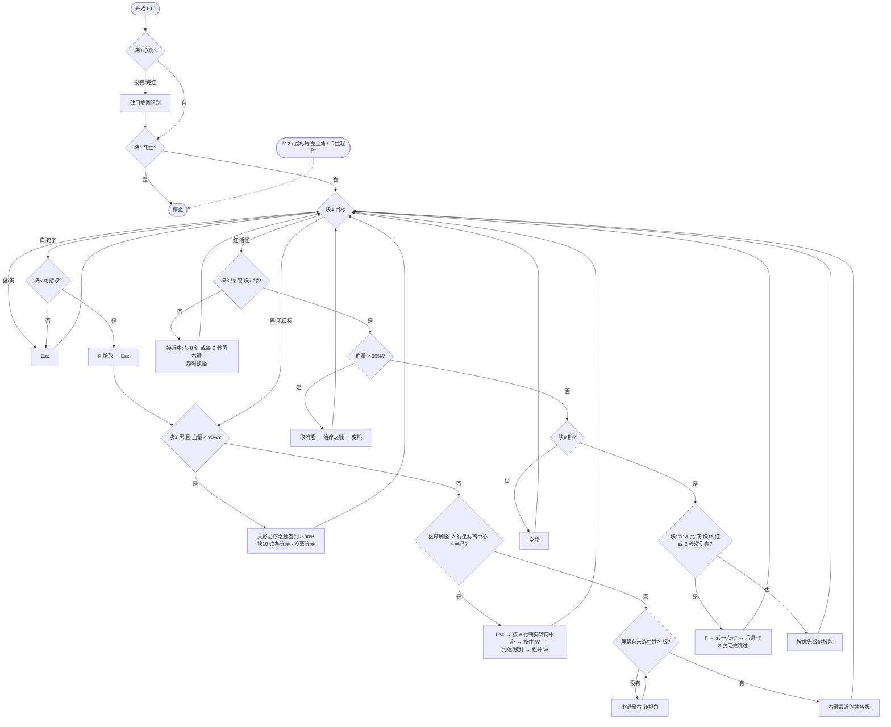

# BotStatus：把角色状态变成色块给 WowGrinder 读

目的：游戏里在屏幕左上角画一排纯色小方块，Python 截这一小块就能知道“血量多少、有没有目标、是否面向错误、是否超出距离、是否在战斗、目标死没死、自己死没死、是不是熊形态”等状态，比识别血条和图标稳定得多。

> **v0.7（WowGrinder v8）：** 第 1 行增加块 22（目标姓名板标记状态）和块 23（面向错误计数）；在**当前目标的姓名板上方**画一个 20×12 的小标记（黑底，左 8×8 青、右 8×8 洋红），锚在 `C_NamePlate.GetNamePlateForUnit("target")` 上（pcall 包住；只是把自己的框锚过去，不读姓名板坐标）。Python 在屏幕上找这个标记来判断怪在左/右/身后。版本块改为**白**（Python 也接受 v0.5/v0.6）。
>
> **v0.6：给原地 Tab 打怪用。** 编码和块位置不变，版本块改为**黄**（Python 也接受 v0.5）。块 13“目标在打我”增加备用判断（UnitThreatSituation 2/3）；块 16“普通攻击够不够得到”和块 13 都用 pcall 包住。
> **v0.5：普通攻击距离 + 补救用的信号。** 新增块 16-21：普通攻击是否够得到（在动作条 1-120 格里找“攻击” spellID 6603，用 `IsActionInRange`；不用裂伤）、面向错误/太远/视线 3 个独立报错块（各亮 1.5 秒）、动作条上有没有“攻击”、进度条是否正常。A 行新增“距上次对目标打出伤害的秒数”（战斗日志可用时）。进度条改为优先用 当前值/最大值（StatusBar 原生接受机密值），修复战斗中读不到血量。版本块改为洋红。
> **v0.4：抗伽马/亮度。** 实机发现游戏 `Config.wtf` 里 `SET Gamma "1.2"` 会把中间色调亮（128→144），v0.3 的坐标块校验全错。v0.4 所有颜色只用 0/255 通道（8 种纯色），数值改成二进制块；Python 每个通道按 128 二值化，伽马、亮度、对比度怎么调都不影响。去掉了橙色/灰色。
> v0.3：新增块 16-19（地图坐标 X/Y、朝向、地图 ID），给“区域刷怪”用。
> v0.2：Python 机器人已经接入（`bot/addon_reader.py`），优先读这些色块；心跳读不到时自动改用截图识别。新增块 14（自动攻击）和块 15（法力%）。

---

## 1. 先说结论（兼容性很重要）

1. **《魔兽世界：无限》（WoW Forever，客户端 1.60.1，TOC `16001`）用的是正式服（Midnight 12.x）的界面代码，暴雪确认 Midnight 的“插件削弱 / 机密值（secret values）”在无限里同样生效。**
   来源：<https://warcraft.wiki.gg/wiki/Patch_1.60.1/API_changes>（“The addon disarmament changes introduced in Midnight, including secrets, will also be active in Forever.”）
2. 机密值的意思：战斗中 `UnitHealth`、`UnitPower`、`UnitHealthPercent` 等返回的是“黑盒”，插件**不能比较、不能做加减乘除**，否则报错。但可以直接交给 `StatusBar:SetValue()`、`Texture:SetVertexColor()` 这类原生函数去画。
   来源：<https://warcraft.wiki.gg/wiki/Patch_12.0.0/Planned_API_changes>、<https://warcraft.wiki.gg/wiki/API_UnitHealthPercent>、<https://warcraft.wiki.gg/wiki/ScriptObject_ColorCurveObject>、<https://warcraft.wiki.gg/wiki/API_StatusBar_SetValue>
   → 所以老式“把血量算成数字再编码成颜色”的像素插件，**在无限里一进战斗就会坏**。本插件改用**颜色曲线**（C++ 层把血量% 变成红色深浅）和**原生进度条**，绕开了运算，属于暴雪允许的“显示类”用法。
3. **官方 WeakAuras 目前没有无限版本**，装不上（截至 2026-11-08）。社区有两个分支：WeakAurasForever（alpha，官方 WA 字符串大多不兼容）和 Musca Auras。
   来源：<https://wowforeverguides.com/addons/weakauras>、<https://github.com/Jared-Mac/WeakAurasForever>
   → **推荐直接用下面的独立小插件 BotStatus**，装法比 WA 简单，也不依赖第三方分支。
4. 没有提供 WA 导入字符串：WA 字符串要用 LibSerialize+LibDeflate 编码，而且无限上没有官方 WA、分支兼容性不明，我没法在游戏里验证，就不给一个可能导不进去的假字符串。WA 做法见第 6 节（手动建，5 分钟）。
5. 以下 API 在 Warcraft Wiki 标注为无限可用且**不是机密值**：`UnitAffectingCombat`、`UnitIsDead`、`C_Spell.IsSpellInRange`、`CanLootUnit`、`UI_ERROR_MESSAGE` 事件。血量/怒气是机密值，已用曲线+进度条处理。插件**还没在游戏里实测**，第一次用请按第 5 节自检。

---

## 2. 网上找到的现成方案

| 名称 | 链接 | 说明 | 适合直接用吗 |
|---|---|---|---|
| WowClassicGrindBot + DataToColor 插件 | <https://github.com/Xian55/WowClassicGrindBot>（插件在 `Addons/DataToColor`） | 最成熟的开源像素打怪机器人（C#，373★，2026-10 仍在更新），插件把 100 多项数据编码成顶部一排像素 | ❌ 只有经典怀旧服/TBC/WotLK 的 toc，没有无限(16001)版；按数值编码，碰到机密值会坏。适合参考思路 |
| DataToColor 协议说明（DeepWiki） | <https://deepwiki.com/daxiazh/WowClassicGrindBot/4.4-addonreader-and-state-parsing> | 讲了像素帧怎么排、怎么解析 | 参考 |
| Shigure（像素协议插件） | <https://github.com/waynebian01/Shigure>，说明 <https://deepwiki.com/waynebian01/shigure/2.1-addon-core-state-blocks-events-and-pixel-protocol> | 用 RGB 三通道 0–255 编码状态块 | 参考，未针对无限 |
| OwnedCore “从零做像素机器人”教程 | <https://www.ownedcore.com/forums/wow-classic/wow-classic-bots-programs/830719-creating-pixel-bot-c-zero-kinda-tutorial.html> | 有 WA 字符串和独立插件代码，作者 2025 年注明旧 WA 链接已失效 | 参考（网站对脚本访问会 403，浏览器能打开） |
| 机密值开发指南 | <https://github.com/Nakuromi/WoWAddonDevGuide> | 第三方整理，哪些 API 战斗中变机密 | 参考（个别结论和官方 Wiki 不一致，以 Wiki 为准） |

结论：没有现成能在无限上直接用的，所以自己写了 BotStatus。

---

## 3. 色块编码表（v0.4，给 Python 用）

- 位置：屏幕**物理像素**左上角 (0,0)，1920×1080 全屏。每块 10×10，**取样点在块中心**。
- **只用 8 种纯色**：黑(0,0,0) 白(255,255,255) 红(255,0,0) 绿(0,255,0) 蓝(0,0,255) 黄(255,255,0) 青(0,255,255) 洋红(255,0,255)。读取时**每个通道 ≥128 算 1，<128 算 0**，所以伽马/亮度/对比度改了也认得出来。
- **洋红在状态块里表示“读不到/未知”**，遇到就按“不确定”处理。

| 区域 | y 范围 | 内容 |
|---|---|---|
| 第 1 行 | 0–9 | 22 个状态块（块 0–21，x=`i*10…i*10+9`） |
| 进度条 | 10–25 | 4 条 100×4，黑底绿填充：自己血量 / 目标血量 / 怒气 / 法力，**绿色像素数 = %**（战斗中机密值也能画） |
| 二进制 A 行 | 30–39 | X(块 0–6) Y(块 7–13) 朝向(块 14–20) 距上次伤害秒数(块 21–24) |
| 二进制 B 行 | 40–49 | 地图 ID(块 0–6) 血量%(7–10) 目标血量%(11–14) 怒气%(15–18) 法力%(19–22) **版本块 23 = 白（v0.7；v0.6 黄，v0.5 洋红，v0.4 红）** **校准灰 24 = (128,128,128)** |

### 3.1 状态块（第 1 行）

| 块 | 含义 | 颜色 → 值 |
|---|---|---|
| 0 | 心跳 | (255,255,B)，B 每 0.05 秒变化。3 秒不变 = 卡住；**纯红 = 插件出错** |
| 1 | 自己血量（目视） | 红色深浅，Python 不读（改读二进制/进度条 1） |
| 2 | 自己生死 | 绿=活着；红=尸体；**黄=灵魂**；洋红=未知 |
| 3 | 战斗 | 绿=战斗中；黑=脱战 |
| 4 | 目标类型 | 黑=无；红=可攻击活怪；**黄=被别人抢了**；蓝=友方；**白=已死**；洋红=未知 |
| 5 | 目标血量（目视） | Python 不读 |
| 6 | 可拾取 | 绿=有战利品；黑=没有 |
| 7 | 距离 | 绿=近战；黄=约 30 码；红=更远；黑=无目标；洋红=无法判断 |
| 8 | 最近 1 秒红字报错 | 黑=无；红=面向错误；黄=距离；蓝=没目标；洋红=视线；青=移动中；**绿=形态不对**；白=其他 |
| 9 | 形态 | **红=熊**；黑=人形；黄=猎豹；蓝=旅行；白=其他 |
| 10 | 施法 | 绿=读条；蓝=引导；黑=没有 |
| 11 | 怒气（目视） | Python 不读 |
| 12 | 移动中 | 绿/黑 |
| 13 | 怪在打我 | 绿/黑 |
| 14 | 自动攻击 | 绿=开；黑=关；洋红=读不到 |
| 15 | 法力（目视） | Python 不读 |
| 16 | 普通攻击距离（v0.5） | 绿=够得到；红=太远；洋红=判断不了（战斗中 API 不给结果）；黑=无目标/目标已死；**蓝=动作条上没找到“攻击”** |
| 17 | 面向错误（v0.5） | 红=最近 1.5 秒出现“你面朝错误的方向”（ERR_BADATTACKFACING / SPELL_FAILED_UNIT_NOT_INFRONT）；黑=没有 |
| 18 | 太远（v0.5） | 黄=最近 1.5 秒出现“距离太远”（ERR_BADATTACKPOS / SPELL_FAILED_OUT_OF_RANGE）；黑=没有 |
| 19 | 视线（v0.5） | 洋红=最近 1.5 秒出现“目标不在视野中”（SPELL_FAILED_LINE_OF_SIGHT）；黑=没有 |
| 20 | 攻击格子（v0.5） | 绿=动作条上找到了“攻击”；蓝=没找到 → 把 普通攻击 拖到任意格子 |
| 21 | 进度条状态（v0.5） | 绿=正常；红=自己血条画不出来（战斗中读不到血量！）；黄=目标血条画不出来 |
| 22 | 目标姓名板标记（v0.7） | 绿=标记已挂在目标姓名板上；红=有目标但没有姓名板（按 V 打开敌方姓名板）；洋红=被拦/出错；黑=没目标 |
| 25 | 荆棘术（v0.8） | 绿=有，黄=不到 60 秒，黑=没有，蓝=没学会，洋红=读不到 |
| 26 | 野性印记（v0.8） | 同上 |
| 27/28 | v0.8 签名 | 固定 青 / 黄（版本块 3 位已用满）；**v0.10：块 28 = 白**，表示目标姓名板标记画在姓名板正中间（WowGrinder 面向错误时右键点它） |
| 24 | 游戏菜单（v0.7.1） | 白=游戏菜单（Esc 菜单）开着 → Python 按一次 Esc 关掉；黑=没开 |
| 23 | 面向错误计数（v0.7） | 3 位计数 0–7 循环（R=4 G=2 B=1）：每出现一次“你面朝错误的方向”+1。Python 看计数变化，不再靠 1.5 秒灯猜 |

### 3.2 二进制数值

- 每块 3 位：R、G、B 各 1 位（255=1，0=0），从左到右、R→G→B 排列。
- 一个数值 = **[有效位 1][数据位，高位在前][4 位校验]**，末尾补 0 凑满 3 的倍数。校验 = (数据按 4 位一段相加 + 5) % 16。
- 16 位数值占 7 块：X/Y = 坐标(0–1)×65535（显示的 0–100 坐标 = 值/65535×100，Y 向南增大）；朝向 = 弧度/2π×65535（0=北，逆时针）；地图 ID = uiMapID。
- 距上次伤害：7 位占 4 块，0–126 秒；127 = 当前目标还没打出过伤害；有效位 0 = 战斗日志（COMBAT_LOG_EVENT_UNFILTERED）在无限上不可用 → Python 改看目标血条有没有变短。
- 7 位百分比占 4 块（0–100）。**战斗中血量/怒气/法力是机密值，插件拿不到数字 → 有效位 0**，Python 改读进度条。
- 有效位 0 或校验不对 = 读不到（副本里坐标就是这样）。
- 版本块（B 行块 23）必须是白（v0.7）、黄（v0.6）或洋红（v0.5），否则 Python 报“插件版本不对”并改用截图识别。
- 校准灰（B 行块 24）：默认画面下读到约 128；偏离超过 12（例如伽马 1.2 → 约 144）只在日志里提示“游戏伽马/亮度不是默认值”，**不影响识别**。

Python 读取示意（实际实现见 `bot/addon_reader.py`）：

```python
bit = lambda rgb: tuple(int(c >= 128) for c in rgb)          # 每通道二值化
def field(row_y, start, nbits):
    bits = []
    for j in range((1 + nbits + 4 + 2) // 3):
        bits += bit(img[row_y + 5, (start + j) * 10 + 5])
    ...  # 检查 bits[0]==1 和校验
```

---

## 4. 安装独立插件（推荐）

文件：`addon/BotStatus/BotStatus.toc`、`addon/BotStatus/BotStatus.lua`

1. 把整个 `BotStatus` 文件夹复制到 `World of Warcraft\_forever_\Interface\AddOns\`（无限客户端的文件夹名以你电脑上实际的为准，和 `_retail_` 同级；里面没有 `Interface\AddOns` 就自己建）。
2. 进游戏，在角色选择界面左下角“插件”里勾上 BotStatus。如果显示“过期”，勾选“加载过期插件”。
3. 进游戏后左上角应出现一排小方块。`/botstatus hide` 隐藏，`/botstatus show` 显示。
4. 想改位置/大小/判定距离的技能，改 `BotStatus.lua` 顶部的 `CFG`（`meleeSpells`/`rangedSpells` 支持技能 ID 或中文名）。
5. 方块不挂在 UIParent 上，按 Alt+Z 隐藏界面时它仍然显示；大小按物理像素自动换算，和界面缩放无关。

## 5. 第一次使用自检

1. 左上角应有 3 段：一排 24 块、4 条进度条、下面两行杂色二进制块；B 行倒数第 2 块**白**、最后一块灰。选中怪后块 22 变绿，怪的姓名板上方出现青|洋红小标记。块 20 应是绿（找到了普通攻击）。脱战满血：块 2 绿，块 3 黑，进度条 1 满格。
2. 选中一只怪：块 4 红，块 5 亮红，块 7 黄或红，块 13 黑。
3. 背对怪按技能：块 8 闪红 1 秒（面向错误）。离远了按技能：块 8 闪黄。
4. 变熊：块 9 红，进度条 3 随怒气变长。右键点怪开打后块 14 变绿。
5. 打死怪：块 4 变白，块 6 变绿（有战利品时）。
6. 心跳块 0 的蓝色一直在变。若变纯红并在聊天框看到 “BotStatus 出错”，把那行字发给我。
7. 机器人“测试识别”应显示“来源：插件”和坐标。
8. v0.5：选中一只怪，站远：块 16 红；贴近：块 16 绿。背对怪自动攻击：块 17 闪红。打到怪后“测试识别”的“上次伤害”应是几秒前（若显示“插件读不到”说明战斗日志不可用，不影响补救）。

注意：v0.4 不怕游戏伽马/亮度/对比度（只看每个通道是否过半）。仍建议关闭 HDR 和显卡“数字振动”这类极端调色。

---

## 6. WeakAuras 做法（备选，仅当你装了 WeakAurasForever / Musca Auras）

官方 WA 在无限上用不了。如果你装了社区分支，最省事、最稳的做法是**让 WA 托管同一份 Lua**（不要和 BotStatus 插件同时开）：

1. 输入 `/wa`（WeakAurasForever 也可以 `/waf`）打开界面 → 左上 **新建** → 选 **材质（Texture）**。
2. **显示** 页：材质随便选一个，宽高填 1，透明度调到 0（这个光环只是个“壳”，色块由代码自己画）。
3. **触发器** 页：类型选 **自定义（Custom）** → 事件类型 **状态（Status）** → 检查选 **事件（Event(s)）**，事件填 `PLAYER_ENTERING_WORLD` → 自定义触发器填：
   ```lua
   function() return true end
   ```
4. **动作** 页 → **初始化时（On Init）** → 勾 **自定义** → 把 `BotStatus/BotStatus.lua` 的**全部内容**粘进去。
5. **加载** 页：只勾“德鲁伊”。完成后 `/reload`。左上角出现色块即成功。WA 环境里 `/botstatus` 命令可能不生效，不影响色块。

如果你更想用 WA 原生方式一个块一个光环，下面是“面向错误”块的例子（其他报错块照抄、换字符串和颜色即可）：

- 新建 → **材质**，材质路径填 `Interface\Buttons\WHITE8X8`，颜色 (255,0,0)，宽高 10×10，锚点 **屏幕/父框体 左上**，偏移 x=85、y=0。
- 触发器：自定义 → **事件（Event）**，事件：`UI_ERROR_MESSAGE`，**隐藏**选“定时（Timed）”，时长 `1`。
- 自定义触发器：
  ```lua
  function(event, errorType, message)
    return message == ERR_BADATTACKFACING or message == SPELL_FAILED_UNIT_NOT_INFRONT
  end
  ```
- 战斗/目标这类布尔状态可以用 WA 自带触发器（“玩家/单位状态 → 战斗中”“目标 → 存在/敌对/死亡”），无需代码。
- 缺点：WA 的尺寸单位是界面单位不是像素，要像素精确得把界面缩放设成 `768/1080 ≈ 0.711`；血量%在战斗中是机密值，WA 条件里不能拿来比较。所以还是推荐插件版。

---

## 6.5 坐标/朝向 API 限制（v0.3 起）

- 用到 `C_Map.GetBestMapForUnit("player")`、`C_Map.GetPlayerMapPosition(mapID, "player")` 和 `GetPlayerFacing()`。Warcraft Wiki 标注它们在无限（Forever 1.60.1）可用。
  - <https://warcraft.wiki.gg/wiki/API_C_Map.GetBestMapForUnit>
  - <https://warcraft.wiki.gg/wiki/API:C_Map.GetPlayerMapPosition>
  - <https://warcraft.wiki.gg/wiki/API_GetPlayerFacing>
- 这几个不是战斗机密值，但**在副本、团本、战场、竞技场里返回 nil**（7.1.0 起就这样）。插件这时会画洋红，机器人自动暂停区域功能。
- Midnight 的“地图限制”（`addonMapRestrictionsForced`）可能让部分地图 API 在受限地图上失效，表现同上：洋红，安全退化。
- 插件只把数值画成颜色，不做寻路或自动移动。移动由 Python 按键完成。
- 自检：野外站着不动，二进制 A 行颜色固定；原地转身时 A 行右 7 块变化；走动时左 14 块变化；进副本后坐标读不到（有效位 0）。

## 6.6 v0.5 用到的 API 和不确定点

- `GetActionInfo(格子)`、`C_ActionBar.FindSpellActionButtons(6603)`：找“攻击”格子，脱战/战斗中每 2 秒和动作条变化时重找。
- `IsActionInRange(格子)`（或 `C_ActionBar.IsActionInRange`）：Midnight 下战斗中**可能返回机密值或 nil** → 块 16 洋红“判断不了”，程序改用红字报错和目标血条，补救照常工作。
- `COMBAT_LOG_EVENT_UNFILTERED`：Midnight 对插件限制了战斗日志，**很可能拿不到** → A 行“距上次伤害”有效位 0，程序只看目标进度条有没有变短（2 秒/开打 4 秒）。
- `PLAYER_ENTER_COMBAT / PLAYER_LEAVE_COMBAT`：`IsCurrentSpell(6603)` 读不到时用来判断自动攻击开关。
- 全部 `pcall` 包住，任何一个不可用都不会让插件报错。

## 7. 机器人状态（简化版，`bot/state_machine.py`）

| 状态 | 看哪些色块 | 动作 |
|---|---|---|
| 安全检查 | 块 0 心跳；块 2 生死 | 心跳停止或纯红 → 改用截图识别；块 2 红/黄 → 停止 |
| 寻找目标 | 块 4 黑（无目标） | 屏幕里有未选中姓名板 → **右键**最近的那个；没有 → 按一下**小键盘右**转视角，直到看到怪；连续转太多次 → 停止 |
| 清目标 | 块 4 蓝（友方）/黄（被抢） | 按 Esc |
| 接近目标 | 块 4 红，块 3 黑，块 7 不是绿 | 等点击移动走过去；块 8 红（面向错误）或每 2 秒 → 再右键当前目标姓名板；超时 → 换怪 |
| 战斗中 | 块 3 绿 或 块 7 绿 | 块 9 不是红 → 变熊；否则按优先级放技能 |
| 战斗补救（v0.5） | 块 17 红 / 块 18 黄 / 块 16 红 / 块 8 红黄 / 2 秒没伤害（开打 4 秒没伤害） | 按 F → 转一点视角 + F → 后退半步 + F；连续 3 次无效 → Esc、跳过这只怪 30 秒。伤害 = 目标进度条变短 或 A 行“距上次伤害” |
| 战斗治疗 | 进度条 1 < 30%（战斗中一律读进度条） | v8 分步：退熊（确认块 9 不是红）→ 治疗之触（确认块 10 读条，没读条每 0.7 秒重按，最多 5 次）→ 读完 → 变熊；治疗过仍 < 15% → 停止 + 提示音；块 21 红 → 日志大声警告读不到血量 |
| 拾取 | 块 4 白 且 块 6 绿 | 按 F 拾取 → Esc |
| 战后回血 | 块 3 黑 且 血量 < 90% | 人形（块 9 黑）下治疗之触，块 10 读条中就等，法力太低就等；≥ 90% → 变熊；被打（块 3 绿）→ 变熊迎战 |
| 回范围中心 | 块 3 黑，A 行坐标离中心 > 半径 | Esc 清目标 → 按 A 行朝向转向中心 → 按住 W 走，每次循环重读修正；到 半径×0.5 内停；块 3 绿 → 停下迎战；卡住 → 跳+平移，2 次无效停止 |
| 已停止 | — | F12 / 死亡 / 卡住 / 回血超时 / 回中心超时 |

## 8. 状态机流程图



## 9. 文件清单

- `addon/BotStatus/BotStatus.toc`：插件描述（`## Interface: 16001, 120105`）
- `addon/BotStatus/BotStatus.lua`：插件本体（也可整段粘进 WA 的 On Init）
- `addon/README_WA.md`：本说明


## v0.9（WowGrinder v8.15）
| 块 | 含义 |
|---|---|
| 29 | 连击点（3 位 R=4 G=2 B=1，0-7） |
| 30 | 能量档位（3 位，能量% × 7 四舍五入） |
| 31 | 有效位：R=连击点可读，G=能量可读，B=1（v0.9 签名） |

## v0.11
- 块 28 绿 = v0.11 签名（v0.10 白，v0.8/0.9 黄）。
- 每个能打的怪（UnitCanAttack、活的、不是玩家、没被别人抢；当前目标除外）的姓名板正中间画 20x12 黑底 黄|蓝 标记（左 8x8 黄、右 8x8 蓝），WowGrinder 只点这些标记。
- 块 32：R=1（签名），G=姓名板接口能用，B=有怪的状态读不到（机密值，Python 改用模板）。
- 块 33：屏幕上姓名板个数（3 位，最多 7）。

## v0.12（WowGrinder v8.31 自动跑尸）
- 块 34：R=“释放灵魂”框开着（StaticPopup DEATH），G=“复活”框开着（RECOVER_CORPSE），B=知道尸体坐标。
- 块 35：R=姓名板距离 CVar 设好了，G=灵魂状态（标记改成“会打我的怪”：UnitCanAttack(怪, 自己) 或 UnitReaction ≤ 3），B=1（v0.12 签名）。
- 二进制 C 行（y=50..59）：尸体 X(7 块) 尸体 Y(7 块) 复活还要等几秒(4 块，GetCorpseRecoveryDelay) 姓名板显示距离(4 块)，最后一块（24）青 = v0.12 签名。
- 死了/灵魂时：尸体坐标用 C_DeathInfo.GetCorpseMapPosition；当前小地图上没有就往父地图找，A/B 行的坐标/地图 ID 也改用同一张地图。
- 登录 / /reload：nameplateMaxDistance 从大到小试（200/100/80/60/41/40），读回来取实际生效的最大值，nameplateShowEnemies=1；战斗中延后到脱战再设；聊天框打印实际值。

## v0.13（WowGrinder v8.40 Tab 找怪）

- 第 1 行多了 4 块（共 40 块，宽 400 像素）。
- 块 36：R=目标是玩家，G=精英（elite / rareelite / worldboss），B=稀有（rare，非精英，可以打）。
- 块 37：R=“是不是玩家”读得到，G=“精英/稀有”读得到，B=1（v0.13 签名）。
- 块 38+39：等级差 6 位（块 38 RGB = 高 3 位，块 39 = 低 3 位）。0 = 没目标/读不到；63 = 骷髅（??）；其余 = 目标等级 − 自己等级 + 32（1..62）。
- 二进制 C 行第 23 块洋红 = v0.13 签名（和块 37 B=1 一起判断）。
- 全部 pcall + 机密值当读不到；读不到时 WowGrinder 保守处理（不打这个 Tab 目标）。

## v0.15（WowGrinder v8.52 插件报告界面框位置）

- 第 1 行块 42 = R=1（界面框功能）、G=界面显示中（Alt+Z 隐藏 = 0）、B=1（v0.15 签名）。
- 二进制 D 行 y=60..69：界面框个数 n（6 位，块 0-3）、gen（6 位，块 4-7；界面框一变就 +1，0-63 循环）。
- 二进制 E1-E6 行 y=70..129：每行一个框，序号(6 位，块 0-3) 左 x(12 位，块 4-9) 上 y(12 位，块 10-15) 宽(12 位，块 16-21) 高(12 位，块 22-27) gen(6 位，块 28-31)，单位 = 物理像素（和截图一样），y 从屏幕上边往下。
- 每次刷新（0.05 秒）换一页，每页 6 个框，最多 60 个框；Python 收齐同一个 gen 的 n 个框才换成新的一组。
- 框 = UIParent 下面看得见（IsVisible、透明度 > 0.05）、有可见内容、不超过屏幕 1/4 的顶层框；姓名板不算。
  红字报错（UIErrorsFrame）只报最近 5 秒内报错文字实际占的那一块。每 1 秒、登录、改缩放/分辨率、出红字报错时重算。
- 界面隐藏（Alt+Z）时 n = 0：bot 整个屏幕都找红名。
- 色块区域变成 430×130 像素（左上角），bot 找标记时整块跳过。
